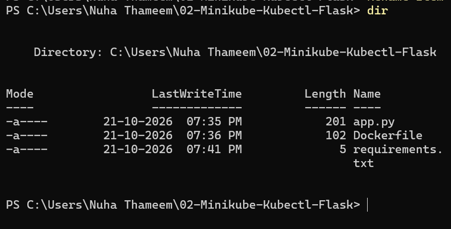
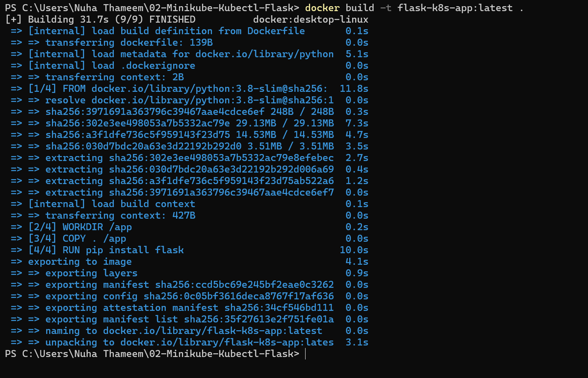
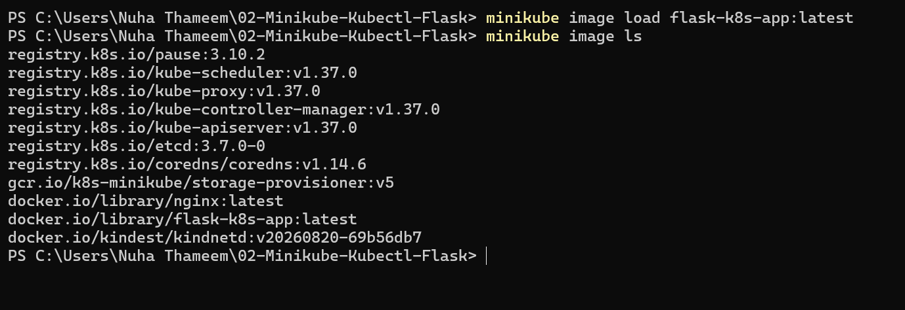
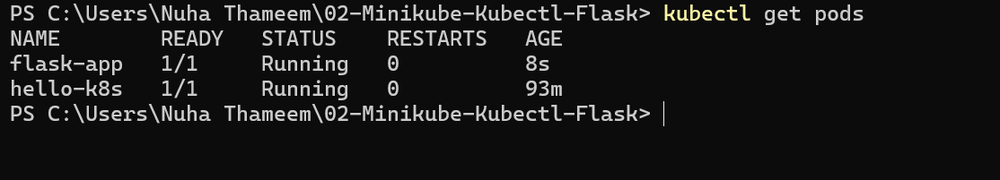
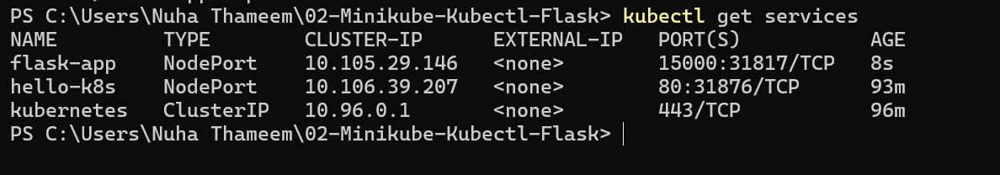
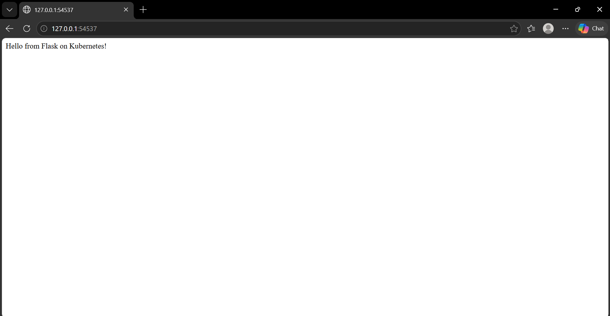

# Exercise 2: Minikube, Kubectl and Flask Deployment

## Objective

Build a Docker image for a Flask application, load it into Minikube, deploy it as a Kubernetes Pod, expose it using a NodePort Service, and access the application through a browser.

## Business Problem

A development team needs to deploy a lightweight Python Flask application on a local Kubernetes cluster. The application must be containerized using Docker, deployed on Minikube, exposed through a Kubernetes Service, and verified through a web browser.

## Technologies Used

- Docker Desktop
- Minikube
- Kubernetes
- kubectl
- Python
- Flask
- PowerShell
- GitHub

## Implementation Steps

### 1. Verify Project Files

The application files were created and verified in the project directory.

### 2. Build the Docker Image

The Docker image was successfully built using the Dockerfile.

### 3. Load the Docker Image into Minikube

The Flask Docker image was loaded into Minikube and verified using the Minikube image list command.

### 4. Verify the Flask Pod

The Kubernetes Pod was verified using `kubectl get pods`. The Flask application Pod reached the Running state.

### 5. Verify Kubernetes Services

The NodePort Service was verified using `kubectl get services`.

### 6. Access the Flask Application in the Browser

The deployed Flask application was accessed successfully through the browser and displayed the message **"Hello from Flask on Kubernetes!"**

## Result

Successfully built a Docker image for a Flask application, loaded it into Minikube, deployed it as a Kubernetes Pod, exposed it through a NodePort Service, and verified the application in a browser.

## Conclusion

This exercise demonstrates the basic Kubernetes deployment workflow using Minikube, Docker, and Flask. It covers container image creation, image loading, Pod deployment, Service exposure, and application verification through a browser.
