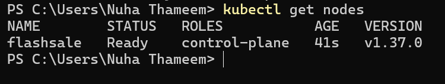
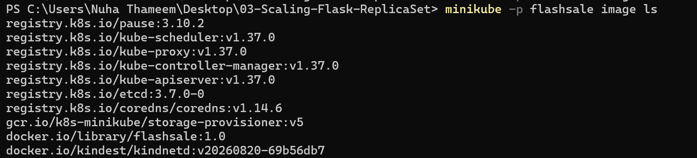
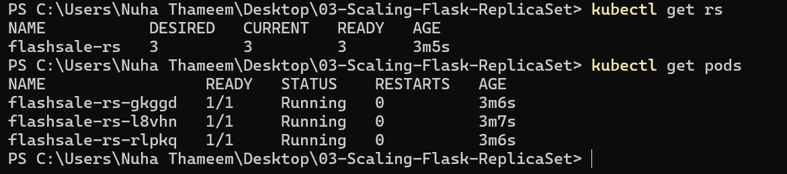
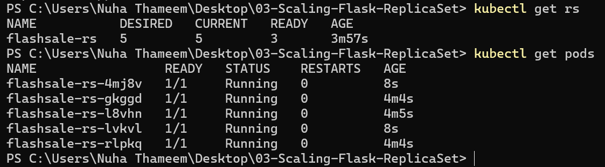
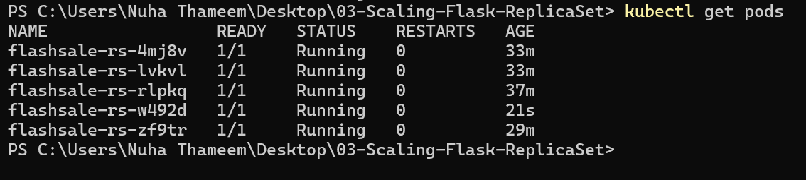
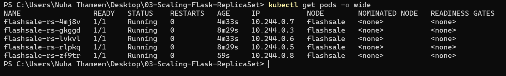

# Exercise 3: Scaling a Flask App on a Single Node using ReplicaSets

## Objective
Understand ReplicaSets and Pods, scale a Flask "flash sale" app from 3 to 5 replicas, watch Kubernetes replace a deleted pod, and see how the pods are placed on a single node.

## What I did
1. Stopped my 3-node `devops-multinode` cluster (not deleted) and started a single-node cluster with `minikube start --nodes=1 -p flashsale --driver=docker`.
2. Wrote `app.py` (Flask app with `/`, `/buy` and `/health`), a `Dockerfile` using gunicorn, and `flashsale-replicaset.yaml` (ReplicaSet with 3 replicas plus a ClusterIP Service).
3. Built `flashsale:1.0` with Docker and loaded it into the cluster with `minikube -p flashsale image load`.
4. Applied the ReplicaSet and Service with `kubectl apply`.
5. Scaled to 5 replicas with `kubectl scale rs flashsale-rs --replicas=5`.
6. Deleted one pod and watched the ReplicaSet create a replacement.
7. Checked placement with `kubectl get pods -o wide`.

## Files
| File | Purpose |
|---|---|
| `app.py` | Flask flash-sale app |
| `Dockerfile` | Builds the image, runs the app with gunicorn on port 5000 |
| `flashsale-replicaset.yaml` | ReplicaSet (3 replicas, probes, resource limits) and ClusterIP Service |

## Results

### 1. Single-node cluster is Ready

### 2. Image loaded into the cluster

### 3. ReplicaSet created with 3 pods Running

### 4. Scaled to 5 replicas

### 5. Deleted one pod, ReplicaSet created a replacement

### 6. All 5 pods on the single node

## Q&A
1. **Initial number of replicas?** 3.
2. **Pods running after applying the ReplicaSet?** 3.
3. **What happens when scaled to 5?** Kubernetes creates 2 additional pods so 5 are running.
4. **What happens when you delete a pod?** The ReplicaSet creates a new pod to replace it, keeping 5 running. I deleted `flashsale-rs-l8vhn` and `flashsale-rs-zf9tr` took its place, which the ReplicaSet events confirm.
5. **How does Kubernetes maintain the desired replicas?** The ReplicaSet controller continuously compares the number of running pods with the desired count and creates or deletes pods to match.
6. **How many nodes are running?** 1 (`flashsale`).
7. **Where do the pods run?** All 5 pods run on the single node `flashsale`.

## Differences from the manual
- **File name:** the manual's Dockerfile copies `ex3-flash-sale.py` but starts `app:app`, so I named the file `app.py` and used `COPY app.py .`.
- **No Docker Hub push:** `image load` puts the image directly on the node, and the YAML uses `imagePullPolicy: Never`.
- **Build before apply:** I built and loaded the image first so the pods start without image errors.
- **Consistent names:** the manual mixes `flashsale-rs` and `flask-app-rs`. I used `flashsale-rs` throughout.
- **No `eval $(minikube docker-env)`:** it is Linux shell syntax and my cluster uses containerd.
- **No cluster deletion:** I used a new profile `flashsale` instead of deleting earlier clusters.