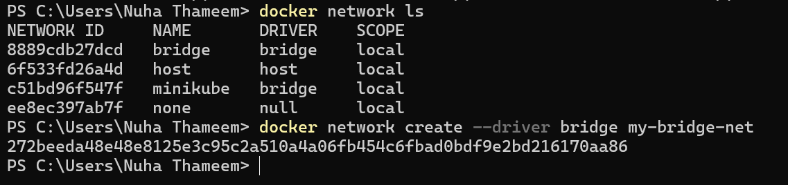
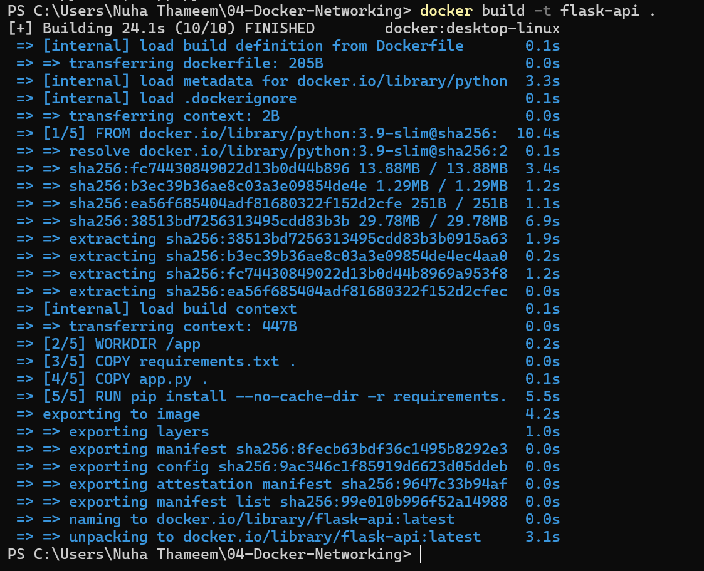
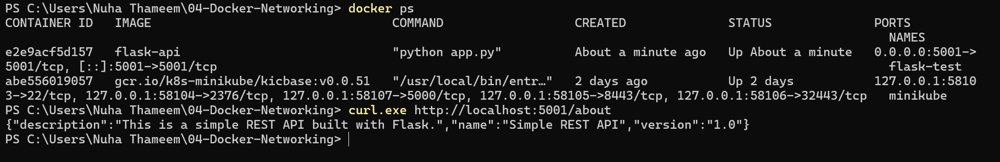
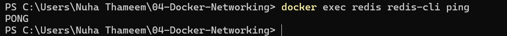
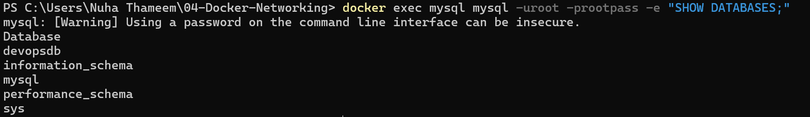

# Docker Networking Lab

## Objective
Build and verify a Flask REST API, MySQL database, and Redis cache using a custom Docker bridge network.

## Technologies Used
- Docker Desktop
- Docker networking (custom bridge)
- Python and Flask
- MySQL
- Redis
- Windows PowerShell

## Application Details
- Flask API endpoint: `http://localhost:5001/about`
- Docker network: `my-bridge-net`
- MySQL database: `devopsdb`
- Containers: Flask, MySQL, and Redis

## Implementation
1. Created the custom bridge network `my-bridge-net`.
2. Created the Flask application and Dockerfile.
3. Built the Docker image `flask-api`.
4. Started the Flask, MySQL, and Redis containers.
5. Connected all three containers to the custom network.
6. Verified the Flask API response.
7. Verified DNS resolution for `mysql` and `redis`.
8. Verified Redis using `redis-cli ping`.
9. Verified MySQL and the `devopsdb` database.

## Verification Results
- Flask API returned the expected JSON response.
- Docker DNS resolved MySQL and Redis container names.
- Redis returned `PONG`.
- MySQL listed `devopsdb` and its system databases.
- All three application containers were running on the custom network.

## Screenshots and Evidence

The following screenshots document the implementation and verification of the Docker Networking lab.

| Screenshot | Evidence |
|---|---|
| [1.png](screenshots/1.png) | Custom bridge network creation |
| [2.1.png](screenshots/2.1.png) and [2.2.png](screenshots/2.2.png) | Network configuration and inspection |
| [3.png](screenshots/3.png) | Docker image build |
| [4.png](screenshots/4.png) | Flask container creation |
| [5.png](screenshots/5.png) | Running containers |
| [6.png](screenshots/6.png) | Flask API response |
| [7.png](screenshots/7.png) | MySQL readiness |
| [8.png](screenshots/8.png) | Flask, MySQL, and Redis running |
| [9.1.png](screenshots/9.1.png) and [9.2.png](screenshots/9.2.png) | Containers connected to the custom network |
| [10.png](screenshots/10.png) | Docker DNS resolution |
| [11.png](screenshots/11.png) | Redis `PONG` response |
| [12.png](screenshots/12.png) | MySQL database verification |
| [13.png](screenshots/13.png) | Final verification |

### Screenshot Gallery

**1. Custom Network Creation**

**3. Docker Image Build**

**6. Flask API Response**

**11. Redis Verification**

**12. MySQL Database Verification**

## Files
- `app.py` — Flask REST API
- `Dockerfile` — Flask image configuration
- `requirements.txt` — Python dependencies
- `screenshots/` — Practical evidence screenshots
