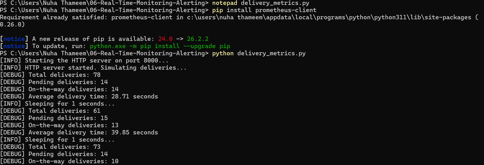
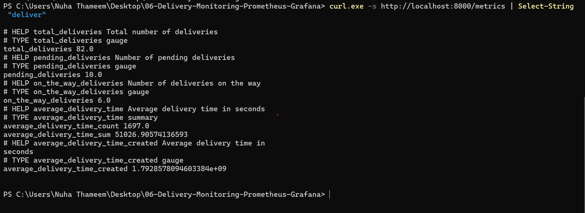
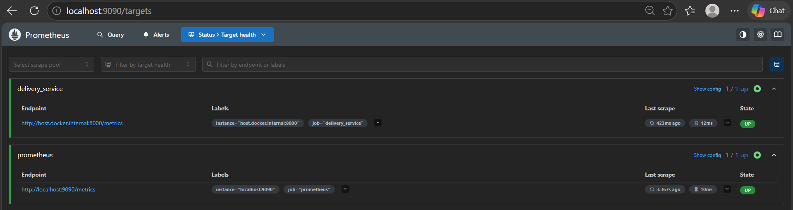
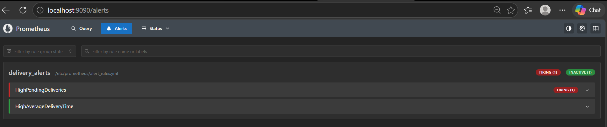
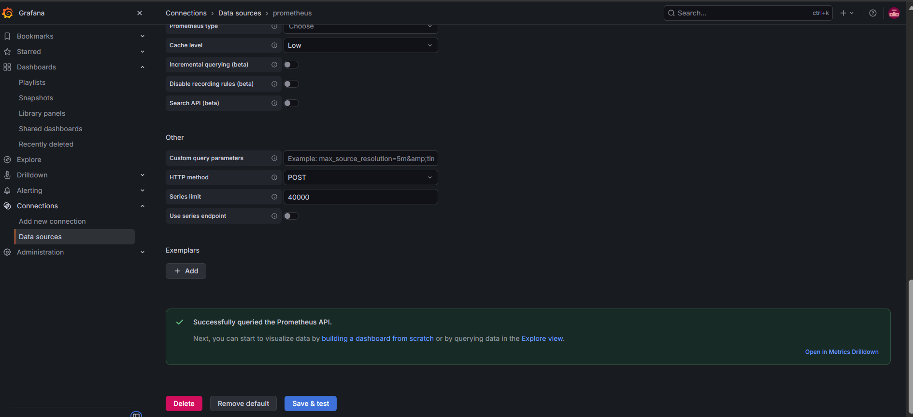
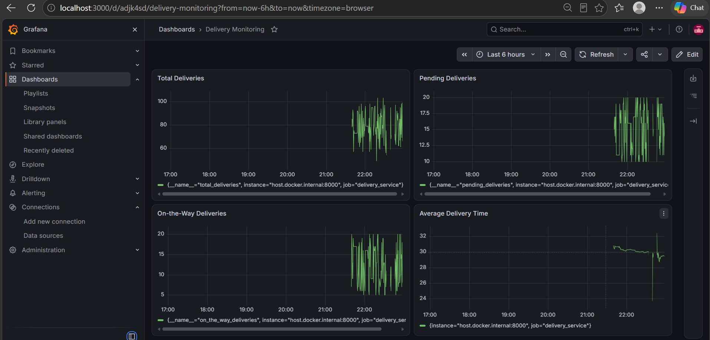
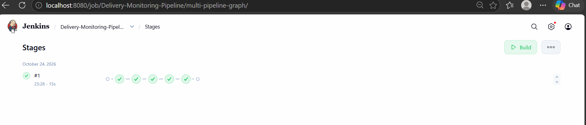
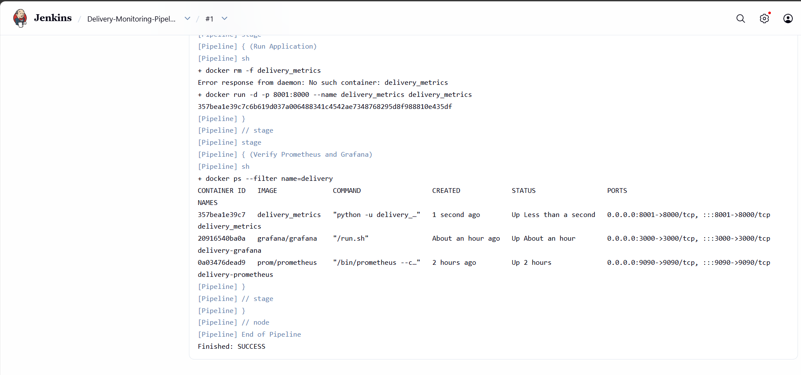

# Exercise 6: Real-Time Operations Monitoring and Alerting

A small monitoring setup for a delivery service (ZAPPTTO). A Python script makes up delivery numbers, Prometheus collects them, Grafana draws them, alert rules fire when the numbers look bad, and a Jenkins pipeline builds and runs the app in Docker.

I did this on Windows with Docker Desktop and PowerShell.

## Files

| File | What it does |
|---|---|
| `delivery_metrics.py` | Simulates deliveries and exposes metrics on port 8000 |
| `prometheus.yml` | Prometheus scrape config |
| `alert_rules.yml` | The two alert rules |
| `Dockerfile` | Packages the Python app for the Jenkins build |
| `Jenkinsfile` | The pipeline script |
| `screenshots/` | Evidence for each step |

## What I did

### 1. Metrics script

`delivery_metrics.py` updates four metrics every second: `total_deliveries`, `pending_deliveries`, `on_the_way_deliveries` and `average_delivery_time`. Run it with:

The metrics are served at `http://localhost:8000/metrics`.

### 2. Prometheus

Prometheus runs in Docker on port 9090 and scrapes the script through `host.docker.internal:8000`. Both targets show UP.

### 3. Alerts

There are two rules:

- `HighPendingDeliveries` fires when `pending_deliveries > 10` for 15 seconds
- `HighAverageDeliveryTime` fires when the average delivery time is above 30 seconds

The simulated pending value is between 10 and 20, so `HighPendingDeliveries` is firing in the screenshot. `HighAverageDeliveryTime` was inactive at that moment.

### 4. Grafana

Grafana runs in Docker on port 3000. The Prometheus data source URL is `http://host.docker.internal:9090`. The dashboard `Delivery Monitoring` has four panels:

| Panel | Query |
|---|---|
| Total Deliveries | `total_deliveries` |
| Pending Deliveries | `pending_deliveries` |
| On-the-Way Deliveries | `on_the_way_deliveries` |
| Average Delivery Time | `average_delivery_time_sum / average_delivery_time_count` |

### 5. Jenkins pipeline

Jenkins runs in Docker on port 8080 with the Docker socket mounted, and the Docker CLI installed inside it. The pipeline job is `Delivery-Monitoring-Pipeline` and has five stages:

1. Pre-check Docker
2. Setup Workspace
3. Build Docker Image
4. Run Application
5. Verify Prometheus and Grafana

Build #1 finished with SUCCESS.

## Changes from the lab manual

The manual is written for Linux, so I changed a few things for Windows:

- Used `host.docker.internal` instead of `172.17.0.1` and `--network=host`
- Used one file name, `alert_rules.yml`, because the manual spells it two ways
- Added a `Dockerfile`, since the manual's Jenkinsfile runs `docker build` but does not give one
- The Setup Workspace stage copies files from a folder inside the Jenkins container, because Jenkins cannot read a Windows path
- The app container in the pipeline uses host port 8001, since port 8000 was already used by the script running locally
- The last stage only checks that Prometheus and Grafana are running, because they were already started earlier on ports 9090 and 3000
