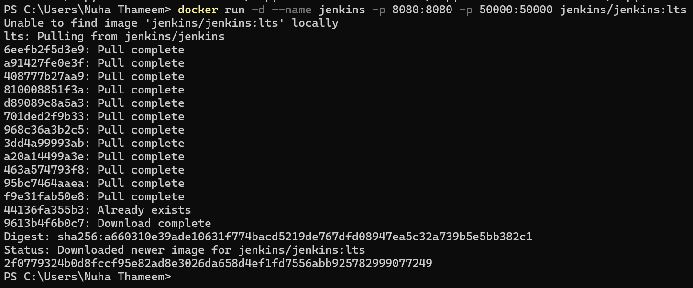
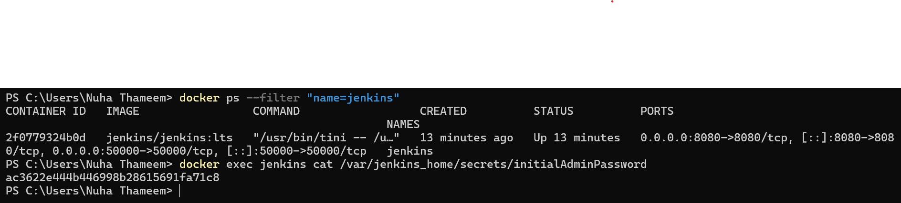
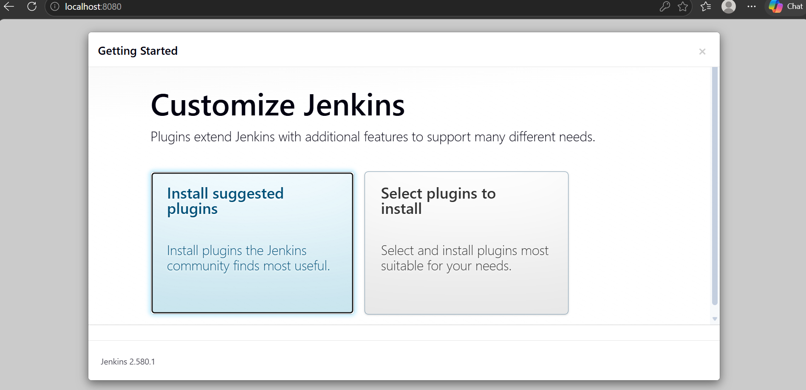
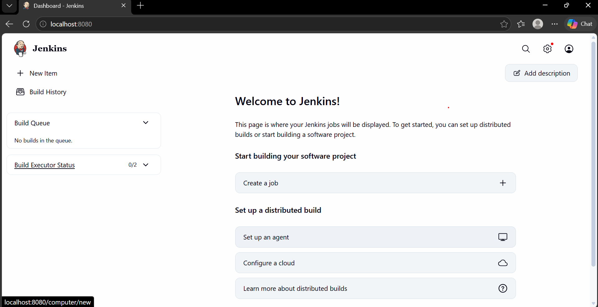

# Exercise 7: Jenkins CI automation

In this exercise I ran Jenkins in a Docker container on my Windows laptop, unlocked it with the initial admin password, installed the suggested plugins, and got to the Jenkins dashboard. Everything was done from Windows PowerShell with Docker Desktop.

## What CI and Jenkins are

Continuous Integration means developers push their changes to a shared repository often, and every push triggers an automated build and test run. If something breaks, the team finds out within minutes instead of weeks later. Jenkins is an open-source automation server that does this work. A job in Jenkins is one task it runs, and a pipeline is a series of those steps (build, test, deploy).

## Step 1: Start Jenkins in Docker

```
docker run -d --name jenkins -p 8080:8080 -p 50000:50000 jenkins/jenkins:lts
```

Docker didn't have the image yet, so it pulled `jenkins/jenkins:lts` first and then started the container. Port 8080 is the web interface and 50000 is for build agents.



## Step 2: Get the initial admin password

```
docker ps --filter "name=jenkins"
docker exec jenkins cat /var/jenkins_home/secrets/initialAdminPassword
```

The first command showed the `jenkins` container up on ports 8080 and 50000. The second printed the one-time password Jenkins asks for on first start.



## Step 3: Unlock Jenkins and customize it

I opened http://localhost:8080/ in the browser and pasted the password into the Unlock Jenkins page. After that, Jenkins offers two choices: install the suggested plugins or pick them by hand. I went with the suggested plugins.



## Step 4: Jenkins dashboard

Once the plugins finished installing, I created an admin user, kept the default URL (http://localhost:8080/), and landed on the Jenkins dashboard.



## Result

Jenkins (version 2.580.1) is running in a container named `jenkins` and is reachable at http://localhost:8080/.
