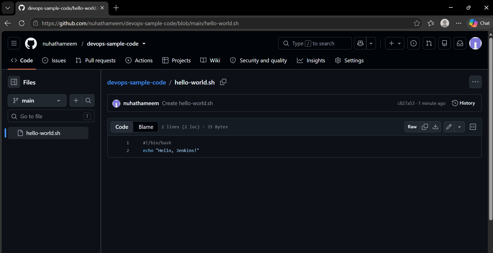
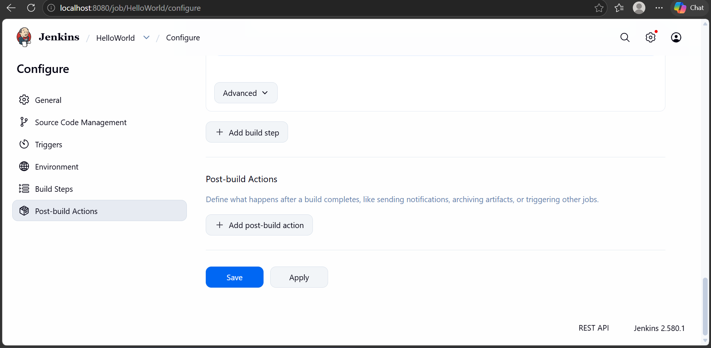
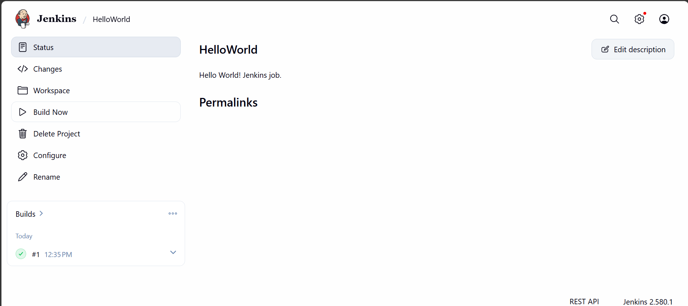
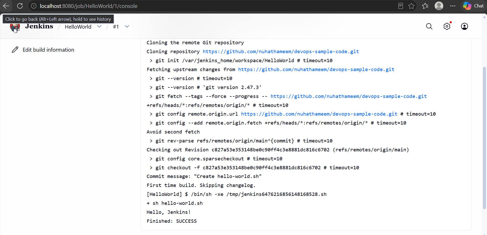

# Exercise 8: Creating a Hello World Jenkins job

In this exercise I wrote a small shell script, put it in a GitHub repository, and set up a Jenkins job that pulls the repository and runs the script. Jenkins is the container from Exercise 7, running at http://localhost:8080/.

## Step 1: The script on GitHub

Git isn't installed on my laptop, so I made the repository and the script in GitHub's web editor. The repository is `nuhathameem/devops-sample-code`, it's public, and the script is `hello-world.sh` on the `main` branch:

```
#!/bin/bash
echo "Hello, Jenkins!"
```

A copy of the script is also in this folder.



## Step 2: The Jenkins job

In Jenkins I created a Freestyle project called `HelloWorld` with the description "Hello World! Jenkins job." Under Source Code Management I chose Git and entered `https://github.com/nuhathameem/devops-sample-code.git`. The branch to build is `*/main`, since that's what the repository uses (Jenkins defaults to `*/master`). The build step is Execute shell with one line:

```
sh hello-world.sh
```



## Step 3: Build Now

I clicked Build Now on the job page. Build #1 finished with a green check.



## Step 4: Console output

The console output for build #1 shows Jenkins cloning the repository, checking out `main`, running `sh hello-world.sh`, and printing `Hello, Jenkins!`. It ends with `Finished: SUCCESS`.



## Result

The HelloWorld job runs the script from my GitHub repository and builds successfully.
