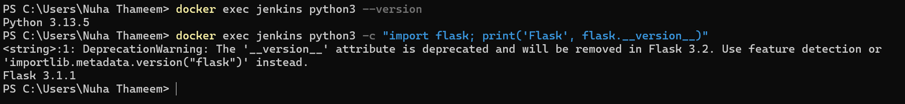
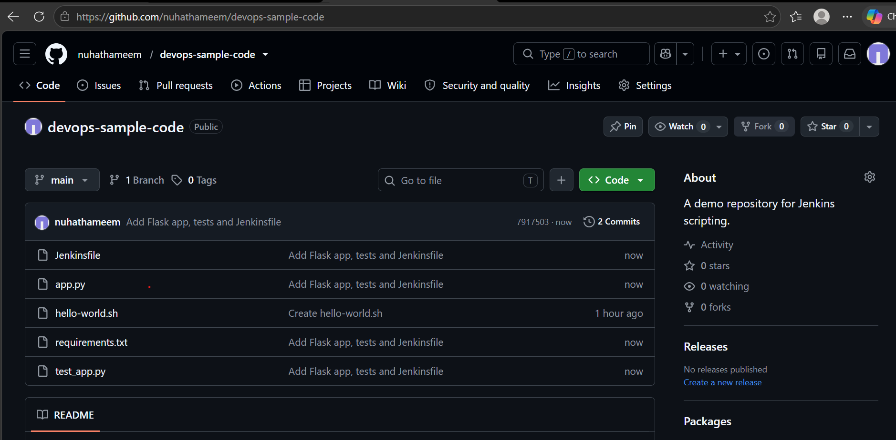
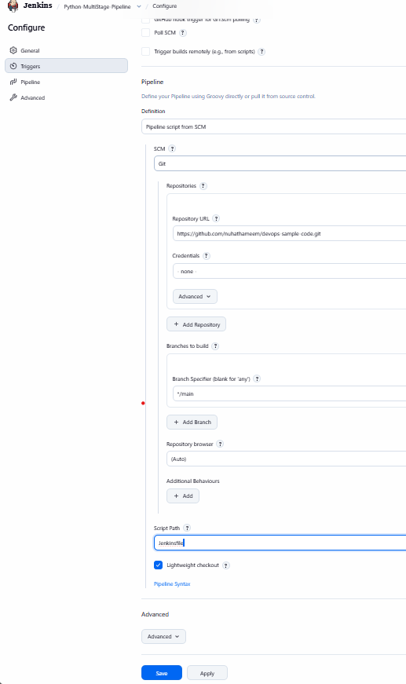
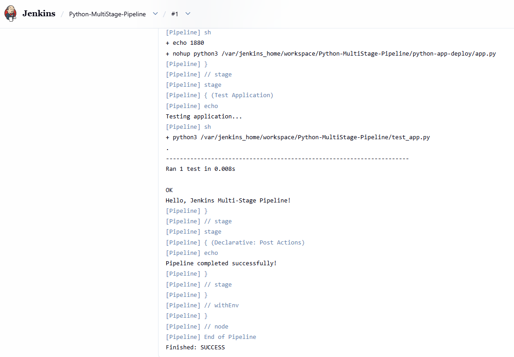

# Exercise 9: Jenkins Multi-Stage Pipeline

## Objective
Create a Jenkins Pipeline that builds, tests and deploys a small Python Flask application, with the pipeline definition stored as a `Jenkinsfile` in GitHub.

## What I did
1. Created the four project files (`app.py`, `requirements.txt`, `test_app.py`, `Jenkinsfile`) from the exercise manual.
2. Uploaded them to my existing public repo `nuhathameem/devops-sample-code`, alongside `hello-world.sh` from Exercise 8.
3. Confirmed Python 3 and Flask are available inside the Jenkins Docker container, since the Jenkins image does not include them.
4. Created a Pipeline job named `Python-MultiStage-Pipeline` using "Pipeline script from SCM" (Git, branch `*/main`, script path `Jenkinsfile`).
5. Ran Build Now. The build finished with `Finished: SUCCESS`.

## Pipeline stages
| Stage | What it does |
|---|---|
| Build | Prints a message (no install step; Flask was already in the container) |
| Test | Runs `python3 -m unittest discover -s .` |
| Deploy | Copies `app.py` into `python-app-deploy/` in the workspace |
| Run Application | Starts the app in the background with `nohup` |
| Test Application | Runs `test_app.py` against the application code |

## Screenshots

### 1. Python and Flask check in the Jenkins container

### 2. GitHub repo devops-sample-code with all five files

### 3. Jenkins job configuration

### 4. Console Output: Finished: SUCCESS

## Notes
- The container has Flask 3.1.1 installed from the Debian package. `requirements.txt` pins Flask 2.1.2, but the Build stage never runs `pip install`, so the tests use the installed version.
- `flask.__version__` prints a deprecation warning in Flask 3.x, so the version was confirmed with `importlib.metadata` instead.
