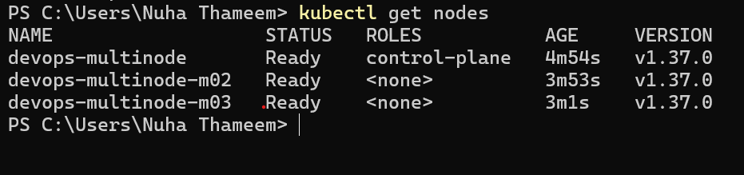
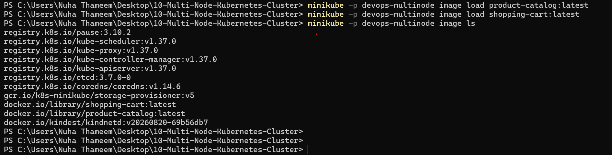
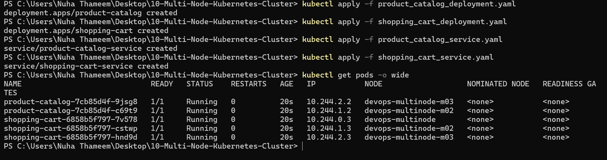
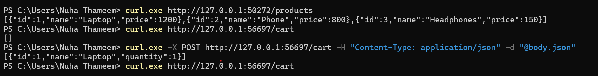

# Exercise 10: Multi-Node Kubernetes Cluster with Multiple Applications and ReplicaSets

## Objective
Deploy two Flask services on a 3-node Minikube cluster: a Product Catalog with 2 replicas and a Shopping Cart with 3 replicas. Pod anti-affinity keeps each app's replicas on different nodes, so one node failing does not take a service down.

## What I did
1. Stopped my older single-node `minikube` profile to free memory (not deleted) and started a new 3-node cluster with `minikube start --nodes 3 -p devops-multinode --driver=docker`.
2. Wrote the two Flask apps, two Dockerfiles, two Deployments and two NodePort Services.
3. Built the images `product-catalog:latest` and `shopping-cart:latest` with Docker.
4. Loaded both images into every node with `minikube -p devops-multinode image load`.
5. Applied the Deployments and Services with `kubectl apply`.
6. Checked pod placement with `kubectl get pods -o wide`.
7. Tested both services with `curl.exe` through `minikube service --url` tunnels.

## Files
| File | Purpose |
|---|---|
| `product_catalog.py` | Flask app, `GET /products` |
| `shopping_cart.py` | Flask app, `GET` and `POST /cart` |
| `Dockerfile.product`, `Dockerfile.shopping` | Image builds for each app |
| `product_catalog_deployment.yaml` | 2 replicas, pod anti-affinity on hostname |
| `shopping_cart_deployment.yaml` | 3 replicas, pod anti-affinity on hostname |
| `product_catalog_service.yaml`, `shopping_cart_service.yaml` | NodePort Services |

## Results

### 1. Three-node cluster, all nodes Ready

### 2. Images loaded into the cluster

### 3. Pods spread across different nodes
- `product-catalog`: one pod on `devops-multinode-m02`, one on `devops-multinode-m03`.
- `shopping-cart`: one pod on each of `devops-multinode`, `devops-multinode-m02` and `devops-multinode-m03`.

### 4. Testing both services with curl
`/products` returned the three products, `/cart` started empty, a POST added the Laptop, and a second GET showed it again.

## Differences from the manual
- **Namespace:** the manual's shopping cart Deployment uses `devops-exercise`, which does not exist, while its Service is in `default`. I used `default` for both.
- **No `--force`:** it is only needed when running as root on Linux. I run Docker Desktop on Windows.
- **No registry add-on:** `image load` copies images to every node, and the Deployments use `imagePullPolicy: Never`, so the registry was not needed.
- **`image ls` instead of `ssh -- docker images`:** my cluster uses the containerd runtime, so `docker` is not available inside the nodes.
- **Tunnels and curl:** on Windows with the Docker driver, `minikube service --url` must stay open in its own terminal, and I used `curl.exe` with the JSON body read from a file (`-d "@body.json"`) to avoid PowerShell quote problems.